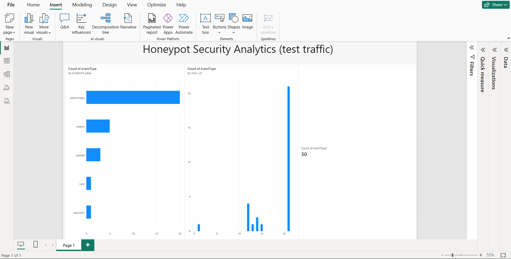

## Detection Testing

Detection rules were tested against 135 attack payloads taken from the public
[PayloadsAllTheThings](https://github.com/swisskyrepo/PayloadsAllTheThings) repository
(78 SQL injection, 57 XSS) and 25 normal inputs.

| Metric | Result |
|---|---|
| Attack payloads detected | 107 of 135 (79%) |
| Correct attack category | 89 of 135 (66%) |
| False positives on normal inputs | 7 of 25 |

Known weaknesses: the rules miss several XSS event handlers (`onfocus`, `onpointer*`, `ontouch*`),
some double-quote SQL injection variants, and flag normal text containing apostrophes, `;`,
or the words `or` / `select` / `union`. Results are from test payloads, not live traffic.

To run the test:

```bash
node test_detection.js
```

## Power BI Report

`analytics/powerbi_dashboard.png` shows a Power BI report built from the logged events
(`analytics/real_logs.csv`, generated with `node convert_logs.js`): total events,
requests per endpoint and activity by hour. The data is my own test traffic.

